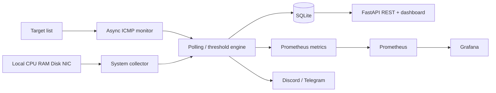

# InfraPulse — Automated Infrastructure Monitor

**InfraPulse** is a lightweight, self-hosted infrastructure monitoring platform built with **Python, asyncio and FastAPI**. It continuously checks ICMP network reachability, records packet loss and latency, samples **local** CPU/RAM/disk usage and local aggregate network throughput, displays the latest data in a responsive web dashboard and exports Prometheus metrics. Optional Discord and Telegram notifications are sent on state transitions.

> Portfolio project: infrastructure automation, networking, Python async I/O, REST APIs, observability, containers and CI.

## Capabilities

| Feature | Implementation |
| --- | --- |
| Network reachability | Async operating-system ICMP `ping`, 3 probes per target (configurable) |
| Packet loss | Percentage of failed ICMP probes per monitoring cycle |
| Latency | Mean RTT of successful replies, when recognizable in the OS ping output |
| Local resources | CPU, RAM, selected disk usage via `psutil` |
| Local bandwidth | Aggregate receive/transmit Mbps derived from `psutil` interface counters |
| Alerting | Down (after repeated failures), recovery, packet loss, resource thresholds |
| Web app | FastAPI REST endpoints + responsive vanilla HTML/CSS/JS dashboard |
| Persistence | SQLite historical measurements/events, default 14-day retention |
| Integrations | Discord webhook, Telegram Bot API, Prometheus `/metrics`, Grafana |
| Delivery | Docker/Compose, Python tests, GitHub Actions |

### Architecture



## Quick start — Windows 10/11 (VS Code)

Install **Python 3.11+** and open this repository in VS Code. In the terminal (**PowerShell**) run:

```powershell
py -m venv .venv
.\.venv\Scripts\python.exe -m pip install -r requirements.txt
.\.venv\Scripts\python.exe -m uvicorn app.main:app --host 127.0.0.1 --port 8000
```

Open **http://127.0.0.1:8000**. Monitoring begins automatically on startup; the first cycle can take several seconds when hosts don't respond. Stop with `Ctrl+C`. For auto-reload while editing, add `--reload` (development only).

**Linux/macOS:**

```bash
python3 -m venv .venv
.venv/bin/python -m pip install -r requirements.txt
.venv/bin/python -m uvicorn app.main:app --host 127.0.0.1 --port 8000
```

On Linux install the OS ping utility if missing (`sudo apt install iputils-ping` on Debian/Ubuntu). Some container/host policies restrict ICMP, resulting in probe errors; ensure ping permissions are enabled.

## Add your router, switch or server

Edit [`config/targets.json`](config/targets.json):

```json
[
  {"name": "Home Router", "host": "192.168.1.1"},
  {"name": "LAN Server", "host": "192.168.1.50"},
  {"name": "Cloudflare DNS", "host": "1.1.1.1"}
]
```

Restart InfraPulse after changing the file. Targets are read at startup. Only monitor devices/networks you are authorized to administer. Some devices/firewalls block ICMP; a failed ping doesn't always imply a device or application outage.

## Configuration

Copy `.env.example` to `.env` and edit it for **Docker Compose**. Docker Compose reads the `.env` automatically. For native Windows/Linux execution, export environment variables in the shell before launching Python; `.env` is **not** loaded automatically by native execution.

| Variable | Default | Description |
| --- | --- | --- |
| `MONITOR_INTERVAL` | `15` | Seconds between cycle starts (minimum 5) |
| `MONITOR_PING_COUNT` | `3` | Probes per target per cycle |
| `MONITOR_FAILURE_THRESHOLD` | `2` | Consecutive down cycles before alert |
| `MONITOR_CPU_ALERT` | `90` | Local CPU warning percentage |
| `MONITOR_RAM_ALERT` | `90` | Local RAM warning percentage |
| `MONITOR_DISK_ALERT` | `90` | Local disk warning percentage |
| `MONITOR_LOSS_ALERT` | `50` | Packet loss warning percentage |
| `MONITOR_RETENTION_DAYS` | `14` | History retention |
| `MONITOR_DISK_PATH` | OS root | Disk volume to sample |
| `MONITOR_DB_PATH` | `data/monitor.db` | SQLite storage path |
| `MONITOR_TARGETS_PATH` | `config/targets.json` | JSON target definitions |
| `DISCORD_WEBHOOK_URL` | empty | Discord webhook for alert messages |
| `TELEGRAM_BOT_TOKEN` | empty | Telegram bot token |
| `TELEGRAM_CHAT_ID` | empty | Telegram chat destination |

Native PowerShell example (current terminal session only):

```powershell
$env:MONITOR_INTERVAL = "10"
$env:DISCORD_WEBHOOK_URL = "https://discord.com/api/webhooks/...."
.\.venv\Scripts\python.exe -m uvicorn app.main:app --host 127.0.0.1 --port 8000
```

No third-party alert is sent until you configure credentials. Alerts are also written to SQLite and visible on the dashboard. **Do not commit `.env` or any webhook/token.**

## Docker and Grafana

```bash
cp .env.example .env                 # PowerShell: Copy-Item .env.example .env
docker compose up --build -d
```

Dashboard: **http://127.0.0.1:8000**

Optional monitoring suite (set a strong `GRAFANA_ADMIN_PASSWORD` in `.env` beforehand):

```bash
docker compose --profile observability up --build -d
```

| Service | URL |
| --- | --- |
| InfraPulse | http://127.0.0.1:8000 |
| FastAPI OpenAPI | http://127.0.0.1:8000/docs |
| Prometheus | http://127.0.0.1:9090 |
| Grafana | http://127.0.0.1:3000 |

Grafana provisions the Prometheus data source and the **InfraPulse - Infrastructure Overview** dashboard automatically. Use the Grafana username `admin` and the password from `.env`.

**Docker namespace warning:** `127.0.0.1` from a container refers to the **container**, not your Windows computer or home router. Likewise, `psutil` values can reflect container namespaces and host-exposed Linux counters rather than a complete Windows host view. For accurate Windows host resources, run Python directly on Windows. Remote devices are monitored for ICMP availability only; remote CPU/RAM or per-switch-port traffic would require agents, SNMP or exporters.

## API

| Endpoint | Description |
| --- | --- |
| `GET /api/health` | Poller state / last error |
| `GET /api/overview` | Current target statuses and local resource snapshot |
| `GET /api/history?limit=80` | Local resource history |
| `GET /api/history?host=1.1.1.1&limit=80` | One target's latency and packet loss history |
| `GET /api/events?limit=20` | Recent stored alerts |
| `GET /metrics` | Prometheus scrape format |
| `GET /docs` | Interactive OpenAPI reference |

These are **read-only**, intentionally unauthenticated endpoints for a local trusted machine. Bind to `127.0.0.1` as shown. Do not expose the service directly to public networks. For external access, deploy behind HTTPS, authentication and appropriate access controls.

## Tests

```powershell
.\.venv\Scripts\python.exe -m pip install -r requirements-dev.txt
.\.venv\Scripts\python.exe -m pytest -q
```

The tests cover target validation, ping result aggregation, alert thresholds/recovery, SQLite history and API endpoints. CI executes the same tests on every push to `main` and pull request.

## Roadmap

- [x] Async ICMP reachability, packet loss, latency
- [x] Local CPU/RAM/disk and bandwidth metrics
- [x] SQLite history, state-change alerts, responsive web UI
- [x] Discord/Telegram alert delivery (optional)
- [x] Prometheus, Grafana and Docker Compose
- [x] GitHub Actions unit tests
- [ ] SNMP v3 per-port throughput for managed switches and routers
- [ ] Remote host agent/exporter for CPU, RAM, disk
- [ ] Authenticated, role-based administration and target CRUD
- [ ] Uptime/SLA reporting and retention aggregation
- [ ] Distributed collectors and high-availability scheduling

## Limitations

- Use a **single Uvicorn worker**; multiple workers would create duplicate pollers and duplicated events.
- ICMP replies may be filtered by firewalls or rate-limited. Latency relies on localized OS ping output; if the RTT cannot be parsed, it remains empty instead of inventing a number.
- Outage confirmation spans two **polls** by default; loss percentage within each poll is derived from the configured probe count.
- Alert notifications are sent best-effort after events are stored. Historical state is kept in SQLite, while alert activation flags reset on service restart.
- Prometheus RTT gauges report `NaN` where an ICMP RTT is unavailable; pair them with `infrapulse_device_up` when querying.

## Repository layout

```text
infra-pulse/
├── app/
│   ├── alerts.py           # Alert state machine
│   ├── config.py           # Settings and target validation
│   ├── main.py             # FastAPI + dashboard routes
│   ├── monitor.py          # Async periodic poller
│   ├── notifier.py         # Discord + Telegram
│   ├── probes.py           # Cross-platform ICMP subprocess calls
│   ├── prometheus.py       # /metrics gauges
│   ├── storage.py          # SQLite history + events
│   ├── system.py           # Local host metrics
│   └── static/             # HTML/CSS/JavaScript dashboard
├── config/targets.json
├── deploy/                 # Prometheus + Grafana provisioning
├── tests/                  # Pytest suite
├── .github/workflows/ci.yml
├── Dockerfile
├── compose.yaml
└── requirements.txt
```

## License

MIT. See [LICENSE](LICENSE).
